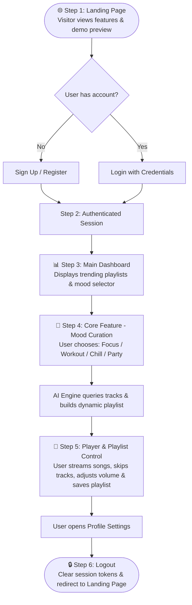

# 📘 Redux Core Concepts — Session 1 Assignment
**Course:** React & Redux Capstone Mini Project  
**Folder:** `Redux core concepts/Session 1`  
**Date:** October 2026  

---

## 📋 Table of Contents
1. [Question 1: Daily App Project Scope Statement](#question-1--daily-app-project-scope-statement)
2. [Question 2: 5 Core Features for Smart E-Commerce Dashboard](#question-2--5-core-features-for-smart-e-commerce-dashboard)
3. [Question 3: 5 AI Features for AI Resume Builder](#question-3--5-ai-features-for-ai-resume-builder)
4. [Question 4: User Interaction Flow Diagram](#question-4--user-interaction-flow-diagram)
5. [Question 5: Capstone Theme Comparison & Choice](#question-5--capstone-theme-comparison--choice)

---

## Question 1 — Daily App Project Scope Statement

> **Question:** Pick any app you use daily (like Zomato, Instagram, Flipkart, or Spotify) and write a short project scope statement describing what problem your React app version would solve and who the main users would be.

### 🎯 Selected App: **Spotify (Music Streaming & Smart Mood Playlist App)**
**App Name:** *SoundPulse — AI-Driven Personalized Music Hub*

### 📝 Project Scope Statement:
* **Core Problem Statement:**  
  Modern music listeners often face "choice paralysis" when browsing millions of tracks on apps like Spotify. Users spend too much time searching for songs that match their current emotional state, productivity needs, or workout intensity, often ending up with repetitive or irrelevant recommendations.

* **Proposed React App Solution:**  
  *SoundPulse* is a single-page React application that simplifies music discovery by allowing users to generate real-time playlists based on **current mood, activity (focus/gym/chill), and temporal preferences (e.g., 90s indie, modern lofi)**. Using React component architecture, Spotify/Last.fm Web APIs, and client-side audio playback controls, it provides seamless audio streaming, instant playlist curation, and synchronized lyric viewing without clutter.

* **Target Audience / Main Users:**  
  1. **Students & Remote Professionals:** People needing distraction-free focus/study playlists tailored to work sessions.
  2. **Casual Music Enthusiasts:** Daily commuters and fitness lovers looking for rapid 1-click playlists matched to their energy levels.
  3. **Indie Artists & Curators:** Users looking to organize, share, and export custom tracklists easily.

* **In-Scope Deliverables:**  
  * User Authentication (OAuth / Mock login)
  * Mood & Activity Selector with dynamic filtering
  * Audio Player with play/pause, seek-bar, volume, and queue controls
  * Playlist CRUD (Create, Read, Update, Delete) with local persistence & state management
  * Responsive UI with modern dark mode aesthetic

---

## Question 2 — 5 Core Features for Smart E-Commerce Dashboard

> **Question:** List 5 core features you would include if you were building a Smart E-Commerce Dashboard (like Flipkart seller panel) in React, and explain in one line how each feature helps the user.

| # | Core Feature | One-Line Explanation of How It Helps The User |
|---|--------------|-----------------------------------------------|
| **1** | 📈 **Real-Time Sales & Revenue Analytics** | Helps sellers track live daily/weekly revenue trends, average order value, and top-performing products to make fast, data-backed business decisions. |
| **2** | 📦 **Smart Inventory & Low-Stock Alerts** | Helps sellers prevent stock-outs by automatically highlighting low-quantity inventory and estimating replenishment timelines before sales are lost. |
| **3** | 📑 **Interactive Product Catalog & Bulk Editor** | Helps sellers rapidly update product pricing, stock levels, categories, and discount tags across multiple items at once without tedious single-item edits. |
| **4** | 🚚 **Order Processing & Shipment Pipeline** | Helps sellers track orders through every stage (New, Packed, Dispatched, Delivered) and generate instant shipping slips in one streamlined view. |
| **5** | 💬 **Customer Review Sentiment & Return Insights** | Helps sellers identify common complaints, defective batches, or high-return reasons early to improve product ratings and customer satisfaction. |

---

## Question 3 — 5 AI Features for AI Resume Builder

> **Question:** Use ChatGPT to brainstorm and list 5 unique features for an AI-powered Resume Builder app that goes beyond just filling forms.  
> *(Hint: Ask ChatGPT for features that use AI to personalize, analyze, or improve resumes.)*

Beyond simple form-filling templates, here are **5 unique AI-driven features**:

1. 🎯 **Target Job Description ATS Match & Keyword Gap Analyzer**  
   * **How it works:** The user pastes a job description (e.g., "Senior React Developer at Flipkart"), and the AI cross-analyzes the resume against the job description. It generates an ATS compatibility score (0–100%) and highlights missing industry keywords and required technical skills.

2. ✨ **AI Impact Bullet Point Rewriter (Action-Verb & Metrics Enhancer)**  
   * **How it works:** Users write basic responsibilities (e.g., *"I made the website faster"*), and the AI rewrites them into quantifiable, high-impact bullet points (e.g., *"Optimized client-side bundle size and asset loading, slashing page load times by 42% and boosting conversion rate"*).

3. 🎭 **Role-Specific Tone & Persona Adapter**  
   * **How it works:** Adjusts the executive summary and project descriptions to match the desired company culture and role seniority (e.g., shifting tone from *Corporate/Executive* for banking to *Innovative/Agile* for early-stage tech startups).

4. 🔍 **Career Gap & Transition Strategy Advisor**  
   * **How it works:** Identifies employment timeline gaps or career-switch challenges and automatically suggests strategic phrasing (functional layout restructuring) and recommends top missing certifications to bridge the gap.

5. 🎙️ **Resume-Derived AI Mock Interview Question Generator**  
   * **How it works:** Once the resume is finalized, the AI extracts projects and tech stacks to generate customized behavioral and technical interview questions, helping the candidate prepare answers using the STAR method (Situation, Task, Action, Result).

---

## Question 4 — User Interaction Flow Diagram

> **Question:** Draw a simple flow diagram (hand-drawn and photographed, or using a tool like draw.io) showing how a user would interact with your chosen app idea — from landing page to main feature completion.  
> *(Hint: Include at least 4 steps, such as login, dashboard, using a main feature, and logout.)*

### 🔄 End-to-End User Interaction Flow (SoundPulse Music App)

```
[ Step 1: Landing Page ]
          │
          ▼
[ Step 2: Authentication ] ─── (Register / Log in)
          │
          ▼
[ Step 3: Main Dashboard ] ─── (Personalized Feed & Mood Selector)
          │
          ▼
[ Step 4: Core Feature Execution ] ─── (Select Mood/Activity -> Generate AI Playlist)
          │
          ▼
[ Step 5: Audio Player & Interaction ] ─── (Play/Pause, Like Track, Save to Library)
          │
          ▼
[ Step 6: Profile & Session Exit ] ─── (View Saved Playlists -> Secure Logout)
```

### 📊 Mermaid Diagram:



> **Visual Asset:** A standalone vector diagram has also been generated at [`flow_diagram.svg`](./flow_diagram.svg) for visual presentation and submission.

---

## Question 5 — Capstone Theme Comparison & Choice

> **Question:** Compare the three example project themes (AI Resume Builder, Smart E-Commerce Dashboard, AI Blog Creator) and write which one you would choose for your capstone and why, mentioning at least two reasons based on your interests or career goals.

### ⚖️ Comparison of Project Themes:

| Evaluation Criteria | 📄 AI Resume Builder | 📊 Smart E-Commerce Dashboard | ✍️ AI Blog Creator |
|:---|:---|:---|:---|
| **Core State Complexity** | Moderate (Multi-step form wizard, live preview state, PDF export) | **High** (Global filters, tabular pagination, real-time metrics, inventory CRUD) | Moderate (Rich-text editor content, tag filters, publishing pipeline) |
| **Redux Suitability** | Great for step-by-step form state & active theme presets | **Exceptional** — Best fit for normalized entity caches, order state, cart sync, and analytics filters | Good for draft saves, scheduled posts, and user profile state |
| **UI/UX Focus** | Clean document typography, drag-and-drop sections, PDF styling | Data visualization, KPI summary cards, interactive charts, responsive tables | Clean markdown editor, image upload previews, reading layout |
| **Real-World Demand** | High in HR Tech & EdTech | **Extremely High** across all SaaS, B2B, Fintech, and E-commerce companies | High for content marketing & CMS platforms |

---

### 🏆 My Capstone Choice: **Smart E-Commerce Dashboard**

### 💡 Why I Chose This (Key Reasons Aligned with Career Goals):

1. **Deep Mastery of Redux Toolkit & Complex Global State Management:**  
   An e-commerce dashboard contains multiple interdependent modules: order statuses, live revenue figures, inventory counters, date-range filters, and notification badges. Implementing this project requires setting up a well-structured Redux store (slices for `orders`, `products`, `analytics`, and `auth`), handling asynchronous actions with `createAsyncThunk`, and writing memoized selectors (`createSelector`). This directly aligns with the skills tested in senior frontend coding rounds.

2. **Strongest Alignment with Enterprise Frontend Job Roles:**  
   Most corporate and startup React positions involve building and maintaining B2B dashboards, internal tooling, and data-heavy admin consoles rather than simple landing pages. By building a feature-complete dashboard with data tables, sorting/filtering, and interactive charts (using Chart.js or Recharts), my portfolio will demonstrate production-ready engineering capability to tech recruiters.

3. **Hands-on Integration of Data Visualization & Performance Optimization:**  
   Working with large datasets requires practicing client-side pagination, debounced search inputs, and React performance hooks (`useMemo`, `useCallback`). This proves I can build fast, scalable applications that remain responsive under heavy data loads.

---
*Assignment completed for TOPS Technology — React & Redux Capstone Course.*
