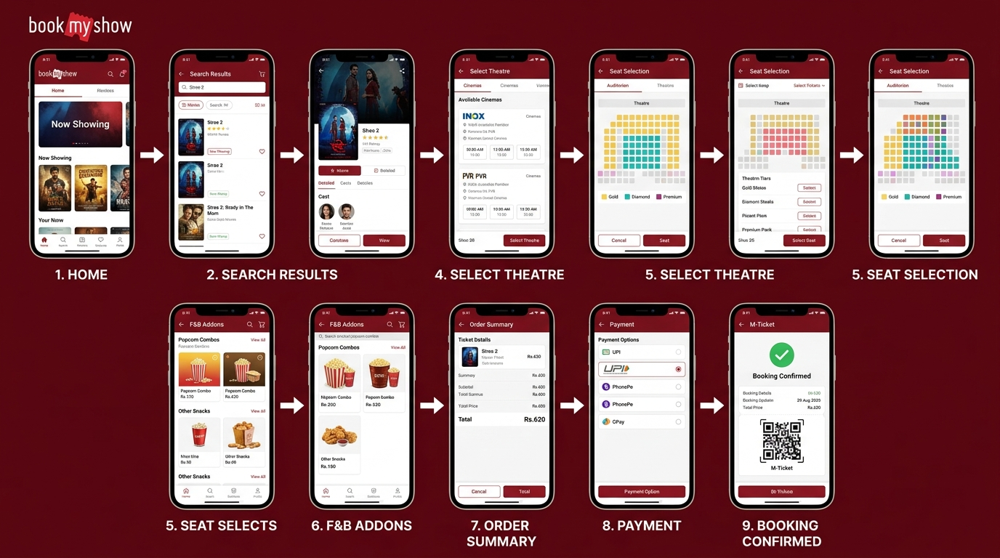

# React Capstone Project — Session 2 Assignment
## UI/UX Design & Wireframing — Q1 to Q4

---

## Question 1 — Low-Fidelity Wireframe: Food Delivery App Homepage

> **Tool Used:** Digital wireframe tool (pen-and-paper style)
> **App Reference:** Zomato / Swiggy

### Wireframe Design Image: Q1_lofi_wireframe_food_app.jpg

### Key Sections Shown in the Wireframe:

| Section | Description |
|---------|-------------|
| **Top Header** | App logo on the left, location pin (current location) on the right |
| **Search Bar** | Full-width search bar: "Search for restaurants, cuisines, dishes..." |
| **Category Filter Chips** | Horizontally scrollable chips: Pizza, Burger, Biryani, Chicken, Desserts, Healthy |
| **Featured Restaurants** | 3 restaurant cards showing image placeholder, name, rating (4.3 stars), delivery time (35-45 mins), price for two |
| **Order Tracking Banner** | Bottom sticky banner showing active order (#1234 - Out for Delivery) with progress bar |

### Why Low-Fidelity?
Low-fidelity wireframes use simple boxes and labels — no colors or fonts — to quickly sketch the layout and structure. This helps in early planning before moving to actual design tools like Figma.

---

## Question 2 — High-Fidelity Wireframe: Music Playlist Dashboard (Spotify-Style)

> **Tool Used:** Figma (High-Fidelity Design)
> **App Reference:** Spotify

### Design Image: Q2_hifi_music_dashboard.jpg

### Three Key Sections in the Design:

#### Left Panel — Playlist List
- Shows all user playlists with thumbnail and name
- Active playlist highlighted in green (Chill Vibes selected)
- Playlists: Chill Vibes, Gym Fuel, Summer Hits, Daily Mix 1-4
- "+" button to create a new playlist

#### Center Panel — Currently Playing Song
- Large album art (After Hours — The Weeknd)
- Song title, artist name, heart (favorite) and queue icons
- Progress bar showing current time: 2:15 / 6:01
- Controls: Repeat, Shuffle, Previous, Play/Pause, Next, Loop

#### Right Panel — User Profile
- User avatar, name (Maya Johnson), followers/following count
- Recently Played section with 4 album thumbnails
- Albums: Blinding Lights, Future Nostalgia, Fine Line, Sour

### Figma Design Choices:
| Property | Value |
|----------|-------|
| Background | #121212 (Spotify dark) |
| Accent Color | #1DB954 (Spotify green) |
| Typography | Circular Std / Inter font |
| Effects | Glassmorphism on cards, gradient behind album art |

---

## Question 3 — User Journey: BookMyShow Movie Ticket Booking

> **App Reference:** BookMyShow
> **Journey:** From opening the app to receiving booking confirmation

### Practical Flow Diagram — All 9 Screens:



> **Diagram shows:** Home → Search Results → Movie Details → Select Theatre → Seat Selection → F&B Addons → Order Summary → Payment → Booking Confirmed (M-Ticket QR)

### Step-by-Step Screens:

```
STEP 1: Open App
  └── Home screen shows Now Showing, Recommended, Events

STEP 2: Search / Browse
  └── Search "Stree 2" OR browse Now Showing

STEP 3: Select Movie
  └── Movie page: Poster, Rating, Cast, Trailer, Reviews

STEP 4: Select City & Theatre
  └── City: Mumbai → Theatres list with timings

STEP 5: Select Date & Showtime
  └── Date picker → 7:30 PM, INOX Malad

STEP 6: Select Seats
  └── Seat map: Gold Rs.250 | Diamond Rs.350 | Premium Rs.450
  └── User picks 2 seats: G7, G8

STEP 7: Add Food & Beverages (Optional)
  └── Popcorn + Cold Drink combo offered

STEP 8: Review Order Summary
  └── Movie + Theatre + Seats + F&B = Rs.620 total

STEP 9: Apply Coupon / Wallet
  └── Promo code or BookMyShow wallet balance

STEP 10: Payment
  └── UPI / Credit Card / Net Banking / BNPL

STEP 11: Booking Confirmed!
  └── QR M-Ticket generated
  └── SMS + Email confirmation sent
  └── Options: Add to Calendar, Share, View Booking
```

### Screens Summary:
| Screen # | Name | Purpose |
|----------|------|---------|
| 1 | Home | Discover movies |
| 2 | Search Results | Find specific movie |
| 3 | Movie Details | Trailer, reviews |
| 4 | Theatre Selection | Pick theatre + time |
| 5 | Seat Selection | Visual seat map |
| 6 | F&B Add-ons | Upsell combos |
| 7 | Order Summary | Review before pay |
| 8 | Payment Gateway | Transaction |
| 9 | Booking Confirmation | QR ticket |

---

## Question 4 — Uizard Prototype: Flipkart-Style Shopping Cart Dashboard

> **Tool Used:** Uizard (Prototype)
> **App Reference:** Flipkart

### Prototype Image: Q4_flipkart_cart_dashboard.jpg

### Layout Hierarchy — What stands out vs secondary:

#### PRIMARY (Most Visible)
- **Product List** — 60% of screen space; each card shows image, name, variant, quantity +/-, price, discount badge
- **"PLACE ORDER" CTA Button** — Bold Flipkart blue (#2874F0), full-width sticky at bottom

#### SECONDARY (Supporting)
- **Price Summary Card** — MRP, Discount (green), FREE Delivery, bold Total
- **Discount Badges** — 40% OFF, 25% OFF, 50% OFF in green to create urgency

### Products in Cart:
| Product | Price | Discount |
|---------|-------|----------|
| Adidas Originals Superstar Sneakers | Rs. 4,999 | 40% OFF |
| Men's Casual T-Shirt | Rs. 899 | 25% OFF |
| Noise Pulse 2 Max Smartwatch | Rs. 2,499 | 50% OFF |
| **Total Payable** | **Rs. 8,397** | Save Rs. 5,600 |

### Design Principles Applied:
- **F-Pattern Reading** — Product name and price placed on left (natural eye scan)
- **Visual Hierarchy** — CTA button is largest; Price Summary is secondary
- **Color Psychology** — Blue = trust & action; Green = savings & positive emotion

---

*Assignment submitted for TOPS Technology — React Capstone Project, Session 2*
