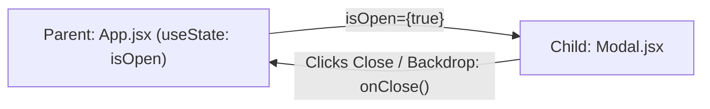

# Session 4: Reusable React Components & Props
**Capstone Mini Project — Assignment Solutions & Practical Guide**

---

## 📌 વિષય સારાંશ (Session Overview)
આ session માં આપણે React ના સૌથી મહત્વના concepts શીખીશું:
1. **Components (કમ્પોનન્ટ્સ)**: UI ને નાના-નાના, ફરી વાપરી શકાય તેવા ટુકડાઓમાં વહેંચવું.
2. **Props (પ્રોપ્સ)**: Parent component માંથી Child component માં data મોકલવો.
3. **State (સ્ટેટ)**: Component ની અંદર dynamic data / visibility manage કરવી (જેમ કે Modal open/close).

---

## 📋 Table of Contents
- [Q1: Zomato-Style Reusable Navbar](#q1-reusable-navbar-component-zomato-style)
- [Q2: Spotify-Style Playlist Card Component](#q2-spotify-style-playlist-card-component)
- [Q3: Flipkart-Style Footer Component](#q3-flipkart-style-footer-with-social-links)
- [Q4: BookMyShow 'Book Ticket' Modal Component](#q4-bookmyshow-book-ticket-modal-component)
- [Q5: Generic Dynamic Form for Cricket Fantasy League](#q5-dynamic-form-cricket-fantasy-league-sign-up)

---

## Q1: Reusable Navbar Component (Zomato-Style)

### 🎯 હેતુ (Goal):
એક Reusable Navbar બનાવવો જેમાં 4 links હોય: `Home`, `Orders`, `Cart`, અને `Profile`. જે link active હોય તે props દ્વારા highlight થવી જોઈએ.

### 💡 Concept (Props & Active Highlighting):
- Parent component માંથી `activeTab="Orders"` prop પાસ કરવામાં આવે છે.
- Navbar દરેક link ને check કરશે: જો `activeTab === link.id` હોય તો તેનો background/text color બદલાઈ જશે.

### 💻 Code Implementation (`Navbar.jsx`):
```jsx
import React from 'react';

export default function Navbar({ activeTab = 'home', onTabChange }) {
  const navLinks = [
    { id: 'home', label: 'Home', icon: '🏠' },
    { id: 'orders', label: 'Orders', icon: '📦' },
    { id: 'cart', label: 'Cart', icon: '🛒', badge: 2 },
    { id: 'profile', label: 'Profile', icon: '👤' },
  ];

  return (
    <nav style={styles.nav}>
      {/* Brand Logo */}
      <div style={styles.logo}>
        <span style={styles.logoRed}>zomato</span>
      </div>

      {/* Navigation Links */}
      <ul style={styles.navList}>
        {navLinks.map((link) => {
          const isActive = activeTab.toLowerCase() === link.id;
          return (
            <li key={link.id}>
              <button
                onClick={() => onTabChange && onTabChange(link.id)}
                style={{
                  ...styles.navButton,
                  ...(isActive ? styles.activeButton : {}),
                }}
              >
                <span>{link.icon}</span>
                <span>{link.label}</span>
                {link.badge && (
                  <span style={styles.badge}>{link.badge}</span>
                )}
              </button>
            </li>
          );
        })}
      </ul>
    </nav>
  );
}

const styles = {
  nav: {
    display: 'flex',
    justifyContent: 'space-between',
    alignItems: 'center',
    padding: '12px 24px',
    backgroundColor: '#ffffff',
    boxShadow: '0 2px 10px rgba(0,0,0,0.08)',
  },
  logo: { fontSize: '24px', fontWeight: 'bold' },
  logoRed: { color: '#E23744', letterSpacing: '-1px' },
  navList: { display: 'flex', listStyle: 'none', gap: '12px', margin: 0, padding: 0 },
  navButton: {
    display: 'flex',
    alignItems: 'center',
    gap: '8px',
    padding: '8px 16px',
    border: 'none',
    borderRadius: '20px',
    backgroundColor: 'transparent',
    color: '#4f4f4f',
    fontSize: '14px',
    fontWeight: '500',
    cursor: 'pointer',
    transition: 'all 0.2s ease',
  },
  activeButton: {
    backgroundColor: '#E23744',
    color: '#ffffff',
    fontWeight: '600',
    boxShadow: '0 2px 8px rgba(226, 55, 68, 0.3)',
  },
  badge: {
    backgroundColor: '#ffffff',
    color: '#E23744',
    borderRadius: '10px',
    padding: '2px 6px',
    fontSize: '11px',
    fontWeight: 'bold',
  },
};
```

---

## Q2: Spotify-Style Playlist Card Component

### 🎯 હેતુ (Goal):
Music playlist માટે એક Card component બનાવવો જેમાં:
- Album Image
- Playlist Name
- Number of Songs
હોય, અને Props દ્વારા data પાસ કરીને 3 અલગ-અલગ playlists render કરવા.

### 💡 Concept (Component Reusability):
- આપણે 1 જ `PlaylistCard` બનાવીએ છીએ, અને તેને `image`, `title`, `songCount`, `curator` જેવા props આપીએ છીએ.
- `playlists.map()` નો ઉપયોગ કરીને એકસાથે 3 કે 300 cards બતાવી શકાય છે!

### 💻 Code Implementation (`PlaylistCard.jsx`):
```jsx
import React from 'react';

// Reusable Single Card Component
export function PlaylistCard({ title, songCount, image, curator, category }) {
  return (
    <div style={cardStyles.card}>
      <div style={cardStyles.imageContainer}>
        
        <button style={cardStyles.playButton} title="Play">▶</button>
      </div>
      <div style={cardStyles.info}>
        <span style={cardStyles.category}>{category}</span>
        <h4 style={cardStyles.title}>{title}</h4>
        <p style={cardStyles.meta}>
          By {curator} • <span style={cardStyles.songCount}>{songCount} songs</span>
        </p>
      </div>
    </div>
  );
}

// Parent List rendering 3 Playlists via Props
export default function PlaylistSection() {
  const playlists = [
    {
      id: 1,
      title: 'Bollywood Romance Top 50',
      songCount: 50,
      curator: 'Spotify India',
      category: 'Romantic',
      image: 'https://images.unsplash.com/photo-1514525253161-7a46d19cd819?w=300&q=80',
    },
    {
      id: 2,
      title: 'Coding & Chill Beats',
      songCount: 38,
      curator: 'Lo-Fi Lounge',
      category: 'Focus',
      image: 'https://images.unsplash.com/photo-1511671782779-c97d3d27a1d4?w=300&q=80',
    },
    {
      id: 3,
      title: 'Gujarati Garba Hits',
      songCount: 45,
      curator: 'Dandiya Vibes',
      category: 'Folk & Festive',
      image: 'https://images.unsplash.com/photo-1470225620780-dba8ba36b745?w=300&q=80',
    },
  ];

  return (
    <div style={{ padding: '20px', backgroundColor: '#121212', borderRadius: '12px' }}>
      <h2 style={{ color: '#ffffff', marginBottom: '16px' }}>🎧 Featured Playlists</h2>
      <div style={{ display: 'grid', gridTemplateColumns: 'repeat(auto-fit, minmax(220px, 1fr))', gap: '20px' }}>
        {playlists.map((pl) => (
          <PlaylistCard
            key={pl.id}
            title={pl.title}
            songCount={pl.songCount}
            image={pl.image}
            curator={pl.curator}
            category={pl.category}
          />
        ))}
      </div>
    </div>
  );
}

const cardStyles = {
  card: {
    backgroundColor: '#181818',
    padding: '16px',
    borderRadius: '8px',
    transition: 'transform 0.2s ease, background 0.2s ease',
    cursor: 'pointer',
  },
  imageContainer: { position: 'relative', width: '100%', aspectRatio: '1/1', marginBottom: '12px' },
  image: { width: '100%', height: '100%', objectFit: 'cover', borderRadius: '6px' },
  playButton: {
    position: 'absolute',
    bottom: '10px',
    right: '10px',
    width: '42px',
    height: '42px',
    borderRadius: '50%',
    backgroundColor: '#1DB954',
    color: '#000000',
    border: 'none',
    fontSize: '16px',
    cursor: 'pointer',
    display: 'flex',
    alignItems: 'center',
    justifyContent: 'center',
    boxShadow: '0 4px 12px rgba(0,0,0,0.5)',
  },
  info: { display: 'flex', flexDirection: 'column', gap: '4px' },
  category: { fontSize: '11px', textTransform: 'uppercase', color: '#1DB954', fontWeight: 'bold' },
  title: { color: '#ffffff', fontSize: '15px', margin: 0, fontWeight: '600' },
  meta: { color: '#b3b3b3', fontSize: '12px', margin: 0 },
  songCount: { color: '#ffffff' },
};
```

---

## Q3: Flipkart-Style Footer with Social Links

### 🎯 હેતુ (Goal):
Flipkart-style Footer બનાવવો જે `socialLinks` array ને prop તરીકે સ્વીકારે અને દરેક link ને icon સાથે render કરે.

### 💻 Code Implementation (`Footer.jsx`):
```jsx
import React from 'react';

export default function Footer({
  socialLinks = [
    { platform: 'Facebook', url: 'https://facebook.com', icon: '🌐' },
    { platform: 'Twitter / X', url: 'https://twitter.com', icon: '🐦' },
    { platform: 'YouTube', url: 'https://youtube.com', icon: '▶️' },
    { platform: 'Instagram', url: 'https://instagram.com', icon: '📷' },
  ],
  companyName = 'Flipkart Internet Pvt Ltd',
}) {
  return (
    <footer style={styles.footer}>
      <div style={styles.container}>
        {/* About Section */}
        <div style={styles.section}>
          <h4 style={styles.heading}>ABOUT</h4>
          <ul style={styles.list}>
            <li>Contact Us</li>
            <li>About Us</li>
            <li>Careers</li>
            <li>Flipkart Stories</li>
          </ul>
        </div>

        {/* Help Section */}
        <div style={styles.section}>
          <h4 style={styles.heading}>HELP</h4>
          <ul style={styles.list}>
            <li>Payments</li>
            <li>Shipping</li>
            <li>Cancellation & Returns</li>
            <li>FAQ</li>
          </ul>
        </div>

        {/* Social Links Section (Passed via Props) */}
        <div style={styles.section}>
          <h4 style={styles.heading}>CONNECT WITH US</h4>
          <div style={styles.socialGrid}>
            {socialLinks.map((item, index) => (
              <a
                key={index}
                href={item.url}
                target="_blank"
                rel="noreferrer"
                style={styles.socialLink}
                title={item.platform}
              >
                <span style={styles.socialIcon}>{item.icon}</span>
                <span style={styles.socialLabel}>{item.platform}</span>
              </a>
            ))}
          </div>
        </div>
      </div>

      <div style={styles.copyright}>
        <p>© 2026 {companyName}. All rights reserved.</p>
      </div>
    </footer>
  );
}

const styles = {
  footer: { backgroundColor: '#172337', color: '#878787', padding: '30px 20px 10px', fontSize: '13px' },
  container: { maxWidth: '1100px', margin: '0 auto', display: 'grid', gridTemplateColumns: 'repeat(auto-fit, minmax(200px, 1fr))', gap: '30px' },
  section: { display: 'flex', flexDirection: 'column', gap: '10px' },
  heading: { color: '#878787', fontSize: '12px', fontWeight: 'bold', marginBottom: '8px', letterSpacing: '0.5px' },
  list: { listStyle: 'none', margin: 0, padding: 0, display: 'flex', flexDirection: 'column', gap: '6px', color: '#ffffff' },
  socialGrid: { display: 'flex', flexDirection: 'column', gap: '8px' },
  socialLink: { display: 'flex', alignItems: 'center', gap: '8px', color: '#ffffff', textDecoration: 'none', fontSize: '13px' },
  socialIcon: { fontSize: '16px' },
  socialLabel: { color: '#ffffff' },
  copyright: { borderTop: '1px solid #454d5e', marginTop: '30px', paddingTop: '15px', textAlign: 'center', fontSize: '12px' },
};
```

---

## Q4: BookMyShow 'Book Ticket' Modal Component

### 🎯 હેતુ (Goal):
જ્યારે button ક્લિક થાય ત્યારે 'Book Ticket' Modal ખુલે.
- Modal ની બહાર (backdrop) ક્લિક કરવાથી બંધ થાય.
- `✕` Close બટન પર ક્લિક કરવાથી બંધ થાય.
- React `useState` દ્વારા visibility control થાય અને `onClose` prop તરીકે પાસ થાય.

### 💡 Concept (State + Prop Callback):


### 💻 Code Implementation (`BookTicketModal.jsx`):
```jsx
import React, { useState } from 'react';

// Reusable Modal Component
export function Modal({ isOpen, onClose, title, children }) {
  if (!isOpen) return null;

  // Backdrop click handler (closes modal when clicking outside content box)
  const handleBackdropClick = (e) => {
    if (e.target === e.currentTarget) {
      onClose();
    }
  };

  return (
    <div style={modalStyles.overlay} onClick={handleBackdropClick}>
      <div style={modalStyles.modalBox}>
        {/* Header */}
        <div style={modalStyles.header}>
          <h3 style={modalStyles.title}>{title}</h3>
          <button style={modalStyles.closeBtn} onClick={onClose}>✕</button>
        </div>

        {/* Body content */}
        <div style={modalStyles.body}>{children}</div>
      </div>
    </div>
  );
}

// Parent Component with State
export default function MovieBookingSection() {
  const [isModalOpen, setIsModalOpen] = useState(false);
  const [tickets, setTickets] = useState(2);
  const [selectedSeat, setSelectedSeat] = useState('Prime - Rs. 250');
  const [bookingSuccess, setBookingSuccess] = useState(false);

  const handleBook = (e) => {
    e.preventDefault();
    setBookingSuccess(true);
    setTimeout(() => {
      setBookingSuccess(false);
      setIsModalOpen(false);
    }, 1500);
  };

  return (
    <div style={{ padding: '24px', textAlign: 'center' }}>
      <h2>🎬 Fighter (3D) - PVR Cinemas</h2>
      <p>Action / Thriller • Hindi • 2h 46m</p>

      {/* Button to Open Modal */}
      <button
        onClick={() => setIsModalOpen(true)}
        style={modalStyles.bookNowButton}
      >
        🎟️ Book Tickets
      </button>

      {/* Reusable Modal */}
      <Modal
        isOpen={isModalOpen}
        onClose={() => setIsModalOpen(false)}
        title="BookMyShow - Ticket Selection"
      >
        {bookingSuccess ? (
          <div style={{ textAlign: 'center', padding: '20px', color: '#2e7d32' }}>
            <h3>🎉 Tickets Confirmed!</h3>
            <p>Confirmation SMS sent to your number.</p>
          </div>
        ) : (
          <form onSubmit={handleBook} style={modalStyles.form}>
            <label style={modalStyles.label}>
              Number of Tickets:
              <select
                value={tickets}
                onChange={(e) => setTickets(e.target.value)}
                style={modalStyles.input}
              >
                {[1, 2, 3, 4, 5, 6].map((n) => (
                  <option key={n} value={n}>{n} Ticket(s)</option>
                ))}
              </select>
            </label>

            <label style={modalStyles.label}>
              Seat Category:
              <select
                value={selectedSeat}
                onChange={(e) => setSelectedSeat(e.target.value)}
                style={modalStyles.input}
              >
                <option value="Classic - Rs. 180">Classic (Rs. 180)</option>
                <option value="Prime - Rs. 250">Prime (Rs. 250)</option>
                <option value="Recliner - Rs. 400">Recliner (Rs. 400)</option>
              </select>
            </label>

            <div style={modalStyles.footerAction}>
              <button
                type="button"
                onClick={() => setIsModalOpen(false)}
                style={modalStyles.cancelBtn}
              >
                Cancel
              </button>
              <button type="submit" style={modalStyles.confirmBtn}>
                Confirm & Pay
              </button>
            </div>
          </form>
        )}
      </Modal>
    </div>
  );
}

const modalStyles = {
  bookNowButton: {
    backgroundColor: '#F84464',
    color: '#ffffff',
    border: 'none',
    padding: '12px 28px',
    borderRadius: '8px',
    fontSize: '16px',
    fontWeight: 'bold',
    cursor: 'pointer',
  },
  overlay: {
    position: 'fixed',
    top: 0,
    left: 0,
    right: 0,
    bottom: 0,
    backgroundColor: 'rgba(0,0,0,0.65)',
    display: 'flex',
    alignItems: 'center',
    justifyContent: 'center',
    zIndex: 9999,
  },
  modalBox: {
    backgroundColor: '#ffffff',
    borderRadius: '12px',
    width: '90%',
    maxWidth: '450px',
    overflow: 'hidden',
    boxShadow: '0 10px 30px rgba(0,0,0,0.3)',
  },
  header: {
    display: 'flex',
    justifyContent: 'space-between',
    alignItems: 'center',
    padding: '16px 20px',
    borderBottom: '1px solid #eeeeee',
    backgroundColor: '#f8f9fa',
  },
  title: { margin: 0, fontSize: '18px', color: '#222222' },
  closeBtn: { background: 'transparent', border: 'none', fontSize: '20px', cursor: 'pointer', color: '#666666' },
  body: { padding: '20px' },
  form: { display: 'flex', flexDirection: 'column', gap: '14px' },
  label: { display: 'flex', flexDirection: 'column', gap: '6px', fontSize: '14px', fontWeight: '500', textAlign: 'left' },
  input: { padding: '10px', borderRadius: '6px', border: '1px solid #cccccc', fontSize: '14px' },
  footerAction: { display: 'flex', justifyContent: 'flex-end', gap: '10px', marginTop: '10px' },
  cancelBtn: { padding: '8px 16px', background: '#eeeeee', border: 'none', borderRadius: '6px', cursor: 'pointer' },
  confirmBtn: { padding: '8px 20px', background: '#F84464', color: '#fff', border: 'none', borderRadius: '6px', fontWeight: 'bold', cursor: 'pointer' },
};
```

---

## Q5: Dynamic Form (Cricket Fantasy League Sign-Up)

### 🎯 હેતુ (Goal):
GitHub Copilot ની મદદથી એક Generic Reusable Form component બનાવવો જે fields નું array prop તરીકે લે અને dynamically inputs render કરે. તેને IPL Fantasy Sign-Up form માટે customize કરવો.

### 💡 Concept (Data-Driven Dynamic UI):
Form ના fields hardcode કરવાના બદલે એક JavaScript array બનાવો:
```javascript
const fields = [
  { name: 'teamName', label: 'Team Name', type: 'text', placeholder: 'e.g. Royal Challengers XI' },
  { name: 'email', label: 'Email Address', type: 'email' },
  { name: 'favTeam', label: 'Favorite IPL Team', type: 'select', options: ['CSK', 'MI', 'RCB', 'GT', 'KKR'] },
  ...
];
```
Form component ફક્ત `fields.map()` કરીને dynamic inputs બનાવી લેશે!

### 💻 Code Implementation (`DynamicForm.jsx`):
```jsx
import React, { useState } from 'react';

// Generic Dynamic Form Component
export function DynamicForm({ title, fields, onSubmit, submitText = 'Submit' }) {
  // Initialize form state dynamically from field names
  const [formData, setFormData] = useState(() => {
    const initial = {};
    fields.forEach((f) => {
      initial[f.name] = f.defaultValue || '';
    });
    return initial;
  });

  const handleChange = (e) => {
    const { name, value, type, checked } = e.target;
    setFormData((prev) => ({
      ...prev,
      [name]: type === 'checkbox' ? checked : value,
    }));
  };

  const handleSubmit = (e) => {
    e.preventDefault();
    onSubmit(formData);
  };

  return (
    <div style={formStyles.container}>
      <h3 style={formStyles.title}>{title}</h3>
      <form onSubmit={handleSubmit} style={formStyles.form}>
        {fields.map((field) => (
          <div key={field.name} style={formStyles.fieldGroup}>
            <label style={formStyles.label}>
              {field.label} {field.required && <span style={{ color: 'red' }}>*</span>}
            </label>

            {/* Select Dropdown */}
            {field.type === 'select' ? (
              <select
                name={field.name}
                value={formData[field.name]}
                onChange={handleChange}
                required={field.required}
                style={formStyles.input}
              >
                <option value="">-- Select an option --</option>
                {field.options.map((opt) => (
                  <option key={opt} value={opt}>{opt}</option>
                ))}
              </select>
            ) : field.type === 'checkbox' ? (
              /* Checkbox */
              <div style={{ display: 'flex', alignItems: 'center', gap: '8px' }}>
                <input
                  type="checkbox"
                  name={field.name}
                  checked={!!formData[field.name]}
                  onChange={handleChange}
                  required={field.required}
                />
                <span style={{ fontSize: '13px' }}>{field.checkboxText}</span>
              </div>
            ) : (
              /* Text, Email, Password, Number Inputs */
              <input
                type={field.type}
                name={field.name}
                value={formData[field.name]}
                placeholder={field.placeholder}
                required={field.required}
                onChange={handleChange}
                style={formStyles.input}
              />
            )}
          </div>
        ))}

        <button type="submit" style={formStyles.submitBtn}>
          {submitText}
        </button>
      </form>
    </div>
  );
}

// Customized for IPL Fantasy League App
export default function IPLFantasySignUp() {
  const fantasyFields = [
    {
      name: 'teamName',
      label: 'Fantasy Team Name',
      type: 'text',
      placeholder: 'e.g. Gujarat Titans Warriors',
      required: true,
    },
    {
      name: 'captainName',
      label: 'Team Captain (Real Name)',
      type: 'text',
      placeholder: 'e.g. Hardik Pandya / Virat Kohli',
      required: true,
    },
    {
      name: 'email',
      label: 'Registered Email',
      type: 'email',
      placeholder: 'user@example.com',
      required: true,
    },
    {
      name: 'favTeam',
      label: 'Favorite IPL Franchise',
      type: 'select',
      options: ['Gujarat Titans', 'Mumbai Indians', 'Chennai Super Kings', 'Royal Challengers Bengaluru', 'Kolkata Knight Riders'],
      required: true,
    },
    {
      name: 'agreeTerms',
      label: 'Terms & Conditions',
      type: 'checkbox',
      checkboxText: 'I confirm I am 18+ and agree to IPL Fantasy Fair Play rules',
      required: true,
    },
  ];

  const handleFormSubmit = (data) => {
    alert(`🎉 Fantasy Team Created Successfully!\n\nTeam: ${data.teamName}\nCaptain: ${data.captainName}\nFranchise: ${data.favTeam}`);
    console.log('Submitted Fantasy Data:', data);
  };

  return (
    <div style={{ padding: '30px', display: 'flex', justifyContent: 'center' }}>
      <DynamicForm
        title="🏏 IPL Fantasy League 2026 - Sign Up"
        fields={fantasyFields}
        onSubmit={handleFormSubmit}
        submitText="Create Fantasy Team 🚀"
      />
    </div>
  );
}

const formStyles = {
  container: {
    maxWidth: '460px',
    width: '100%',
    padding: '24px',
    borderRadius: '12px',
    backgroundColor: '#ffffff',
    boxShadow: '0 8px 24px rgba(0,0,0,0.1)',
  },
  title: { textAlign: 'center', color: '#1a237e', marginBottom: '20px' },
  form: { display: 'flex', flexDirection: 'column', gap: '16px' },
  fieldGroup: { display: 'flex', flexDirection: 'column', gap: '6px' },
  label: { fontSize: '13px', fontWeight: '600', color: '#333333' },
  input: {
    padding: '10px 12px',
    borderRadius: '6px',
    border: '1px solid #cfd8dc',
    fontSize: '14px',
    outline: 'none',
  },
  submitBtn: {
    backgroundColor: '#ff6f00',
    color: '#ffffff',
    padding: '12px',
    border: 'none',
    borderRadius: '8px',
    fontWeight: 'bold',
    fontSize: '15px',
    cursor: 'pointer',
    marginTop: '10px',
  },
};
```

---

## 🚀 まとめ (Quick Comparison of 5 Tasks)

| Question | Component Name | Real-World Inspiration | Core React Concept Demonstrated |
|---|---|---|---|
| **Q1** | `Navbar` | **Zomato** | Props, Conditional Styling (`isActive`) |
| **Q2** | `PlaylistCard` | **Spotify** | Reusable Components, `.map()` rendering |
| **Q3** | `Footer` | **Flipkart** | Array of Objects passed as Props |
| **Q4** | `BookTicketModal` | **BookMyShow** | React State (`useState`), Backdrop click, Callback Prop (`onClose`) |
| **Q5** | `DynamicForm` | **IPL Fantasy League** | Dynamic Form Generation via Config Array |
